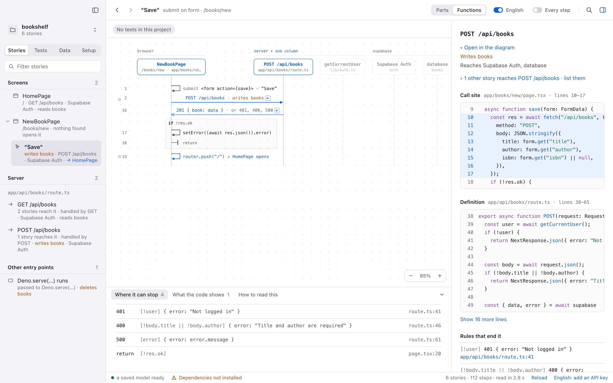

# plainfold

**Read a codebase as stories.** plainfold reads a project's source and shows what it does as sequence diagrams: what happens when a screen opens, a button is pressed, a request arrives or a job runs. Every step leads down to the lines that wrote it.

[**Live demo**](https://alpcakin.github.io/plainfold/) (the real interface, in the browser, on four projects) · [How it was built with Claude Code](#how-i-worked-with-claude-code) · [Checks](https://github.com/alpcakin/plainfold/actions/workflows/ci.yml)

<picture>
  <source srcset="docs/screenshots/story-dark.png" media="(prefers-color-scheme: dark)">
  
</picture>

## What it does

- **Finds where things start.** Screens, buttons and forms, HTTP endpoints, scheduled jobs, the app's start. Framework adapters know the conventions (a Next.js page, a FastAPI route, an APScheduler job). Without an adapter, a story starts wherever the code shows that something outside calls a function.
- **Draws each one as a diagram.** Columns are the places the code runs (browser, server, device), the packages and services it reaches, or the functions. Calls start closed and open in place. Numbers keep their place when a call opens, like line numbers in an editor that folds.
- **Shows where it can stop.** A `throw` or an early `return` is a row where it is written, with its condition. Under the diagram, every way the story ends (`401`, `redirect /sign-in`), with its file and line.
- **Follows calls across languages.** A `fetch` in React to the Next.js route that answers it, a generated API client to a FastAPI endpoint, Dart's `http` to a Python server.
- **Says what changed.** Two readings are compared like `git diff`, story by story. A renamed or moved function is matched by its code, so its story says "renamed from …" instead of showing one removed and one added.
- **Leads down to the code.** The panel shows a step's call site and its definition, the rules that end it, and how many other stories reach it.
- **Optional plain English.** A model can write one short sentence per step with the user's own key. Each sentence is checked against the code; one that fails is dropped and the code's own text stays.

## How I worked with Claude Code

plainfold was written with [Claude Code](https://claude.com/claude-code) as a pair: I decided what to build, set the rules the agent works by and checked its results. That setup is part of the repository:

- **Rules, per folder.** [`CLAUDE.md`](CLAUDE.md), and one each in [`core/`](core/CLAUDE.md), [`app/`](app/CLAUDE.md) and [`spike/`](spike/CLAUDE.md). They hold what an agent gets wrong over many sessions on one codebase. The main rule is against overfitting: no file, function or framework name in a heuristic, and every fix checked on two unrelated projects. Others: type-checking is not verification, a gap stays visible instead of guessed, private code never reaches a commit.
- **Checks before "done".** [`core/scripts/check.mjs`](core/scripts/check.mjs) reads 15 projects with the last commit's core and with the change, and prints every story that differs. The agent reads each difference and reports it. The [`look`](.claude/skills/look/SKILL.md) skill takes screenshots of the view in four looks (light and dark, macOS and Windows) after every view change.
- **A decision log.** [`DECISIONS.md`](DECISIONS.md) labels every product decision Decided, Proposed, Built or Open. The agent can propose and build; only I mark a decision Decided. It is rewritten when a decision changes, so it says what is true now. [`TODO.md`](TODO.md) is what is left.
- **One way to commit.** The [`commit`](.claude/skills/commit/SKILL.md) skill updates the decision log, the to-do list and the READMEs in the same commit as the code, runs the checks the change touches, and writes the message in the repository's style.

## What a diagram promises

These rules hold for every project. The core and the view are written to keep them true.

- **Read, never run.** The project's code, scripts and build steps never run. Only the language servers read it.
- **The same code gives the same diagram.** Structure comes from the syntax tree and the language server, never from a model. That is what makes diagrams comparable.
- **Order is source order.** Numbers mean "written in this order". What runs later (callbacks, effects, handlers) is its own labeled frame.
- **Gaps stay visible.** What the core cannot follow is shown as "not resolved", never guessed. Inferred links are dashed.
- **No framework in the core.** Syntax lives in one file per language. Framework knowledge lives in small adapters that say what they handle. With no adapter, the diagram still makes sense.

## Supported

| Language | Language server | Frameworks and libraries |
|---|---|---|
| TypeScript / JavaScript | typescript-language-server | React, React Native, Next.js (app router, server actions, middleware), Expo Router, Supabase, `fetch`, TanStack Query, SWR, react-hook-form, Jest, Vitest, Mocha |
| Python | pyright | FastAPI, APScheduler, supabase-py, pytest |
| Dart | Dart analysis server | Flutter, Riverpod, provider, `http`, `test` |

The desktop app runs on macOS. The Windows look is written but has never been built.

## How it works

```
project folder
  ├─ tree-sitter         syntax, one table per language        core/src/lang/
  ├─ language servers    what each call reaches (LSP)          core/src/lsp.rs, resolve.rs
  └─ adapters            framework conventions                 core/src/adapters/
        │
        ▼
  walker + story builder: entry points, steps, rules, places   core/src/story/
        │
        ▼
  model.json: stories, an index of what reaches what, the code as read
        │
        ├─ diff / renames: what changed between two readings   core/src/diff.rs, renames.rs
        └─ view: story list, SVG diagram, panel                 app/src/ (Tauri shell or a browser)
```

- **Rust core** (`core/`, about 16,000 lines). It runs the language servers as separate processes and uses an answer only once a server is ready: no time limit falls back to early answers. Servers are found on the machine or downloaded, pinned by version and hash.
- **Desktop app** (`app/`). A Tauri 2 shell around the core. The view is plain TypeScript with no framework: the diagram layout, the SVG and the pan and zoom canvas are written by hand. It watches the project and says when files change.
- **Regression check** (`core/scripts/check.mjs`). Reads 15 projects (the sample and 14 open-source ones) with the last commit's core and with the working tree's, then prints every story that differs. A change counts only once it is checked on at least two unrelated projects, so no fix is tuned to one codebase.

The product decisions, built and open, are in [`DECISIONS.md`](DECISIONS.md). What is left is in [`TODO.md`](TODO.md).

## Run it

You need Rust and Node.js 22 or newer.

Read a project from the command line:

```sh
cargo build --release --manifest-path core/Cargo.toml
core/target/release/plainfold-core install samples/bookshelf --store ~/.plainfold   # downloads the TypeScript server
core/target/release/plainfold-core extract samples/bookshelf out/bookshelf.json --store ~/.plainfold
```

Open the model in the view, in a browser:

```sh
cd app && npm install && npm run dev
# http://localhost:1420/?preview=/@fs/<absolute path>/out/bookshelf.json
```

Run the desktop app (macOS). It asks before it downloads a language server:

```sh
cd app && npm install && npm run tauri dev
```

Dart needs `dart` on the PATH and `flutter pub get` run in the project. More commands are in [`core/CLAUDE.md`](core/CLAUDE.md) and [`app/README.md`](app/README.md).

## Status

plainfold is no longer in active development. It works on the languages and frameworks above, but I stopped building it as a product. Static extraction is deterministic, yet the choices behind it are not: where a story starts, what it includes, and how each framework's conventions should read are judgment calls. There is no ground truth to measure a diagram against, so every framework and every new project brings new cases. The repository stays as it was, with its decisions and open questions written down.

## Repository

| Folder | What it is |
|---|---|
| `core/` | The Rust core and its command line |
| `app/` | The Tauri desktop app and the view |
| `demo/` | The browser demo's landing page and saved models |
| `samples/bookshelf/` | A small Next.js and Supabase sample |
| `prototype/` | The first clickable mockup |
| `spike/` | The first TypeScript prototype and measurements, kept for reference models |

## License

[MIT](LICENSE). The demo models hold code from three open-source projects under their own licenses: [`demo/models/THIRD_PARTY.md`](demo/models/THIRD_PARTY.md).
